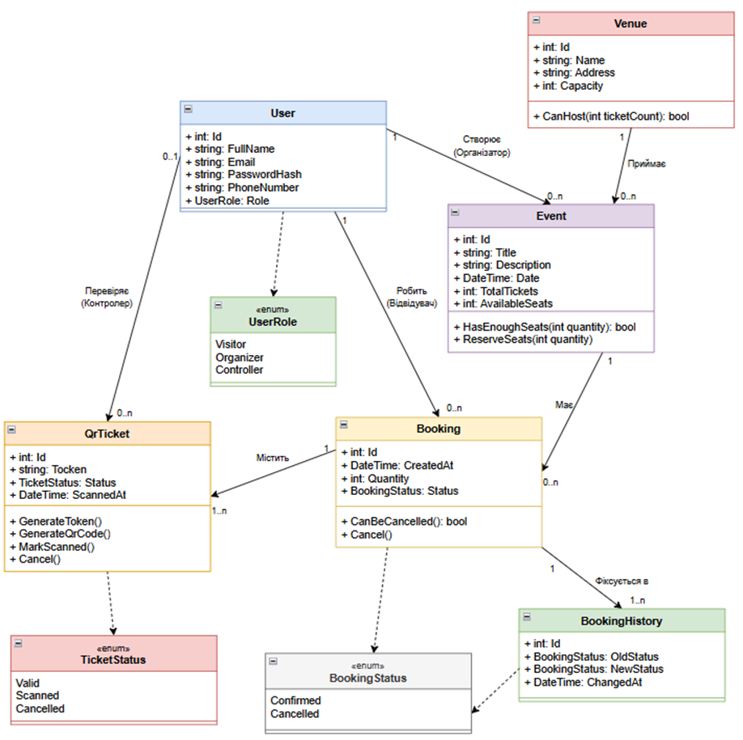

## Class Diagram EventPass v1.0

Діаграма класів описує об'єктну модель EventPass v1.0, яка включає сутність User для зберігання профілю користувача (ПІБ, електронна пошта, телефон, хеш пароля) та його ролі UserRole (Visitor, Organizer, Controller), сутність Venue для локації з назвою, адресою та місткістю Capacity, а також сутність Event із параметрами заходу та залишком місць (AvailableSeats). Сутність Booking фіксує бронювання з кількістю квитків Quantity і статусом BookingStatus (Confirmed / Cancelled), а сутність QrTicket містить унікальний токен Token, статус квитка TicketStatus (Valid / Scanned / Cancelled), час перевірки ScannedAt та операції генерації токена й QR-коду, позначення квитка використаним і його скасування. Сутність BookingHistory зберігає журнал змін статусу бронювання (попередній і новий статус, час зміни).