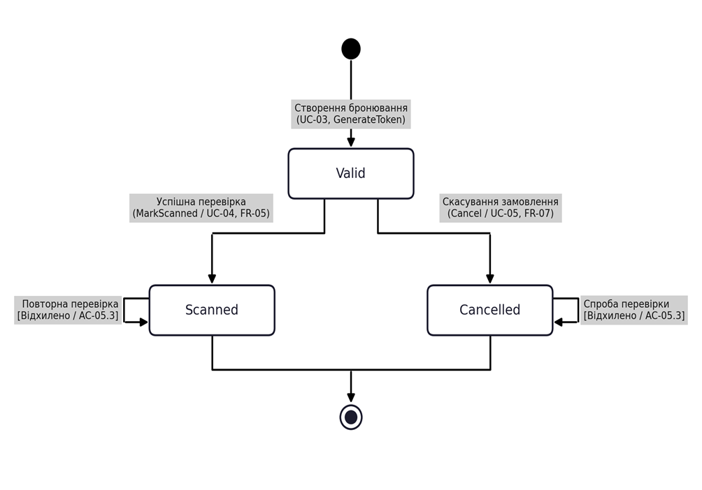

## State Machine Diagram EventPass v1.0

Діаграма станів описує життєвий цикл сутності QrTicket безпосередньо в межах системи EventPass v1.0 без підсистеми онлайн-оплат: після створення бронювання Booking квиток переходить у початковий стан Valid із унікальним токеном і згенерованим QR-кодом, під час перевірки контролером на вході позначається використаним (MarkScanned) та переводиться у стан Scanned, при цьому будь-яка повторна спроба перевірки відхиляється згідно з вимогою FR-05 (AC-05.3), а в разі скасування бронювання квиток набуває термінального стану Cancelled згідно з FR-07 (AC-07). 