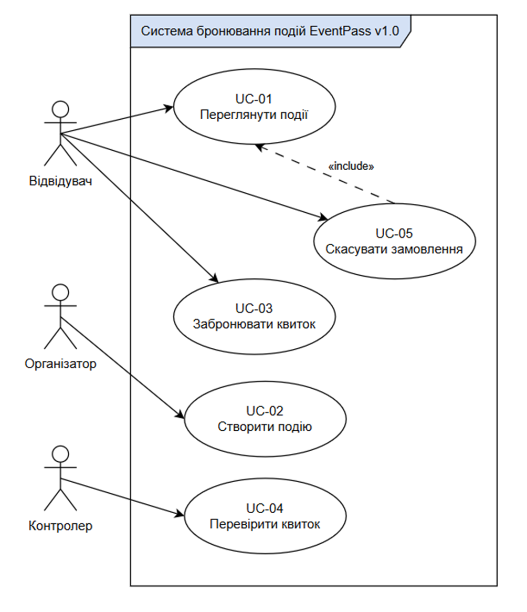

## Загальна Use-Case Diagram EventPass v1.0

Система охоплює трьох основних акторів: Visitor (Відвідувач), Organizer (Організатор) та Controller (Контролер). Головні прецеденти використання: UC-01 (Переглянути події), UC-02 (Створити подію), UC-03 (Забронювати квиток), UC-04 (Первірити квиток), UC-05(Скасувати замовлення).

